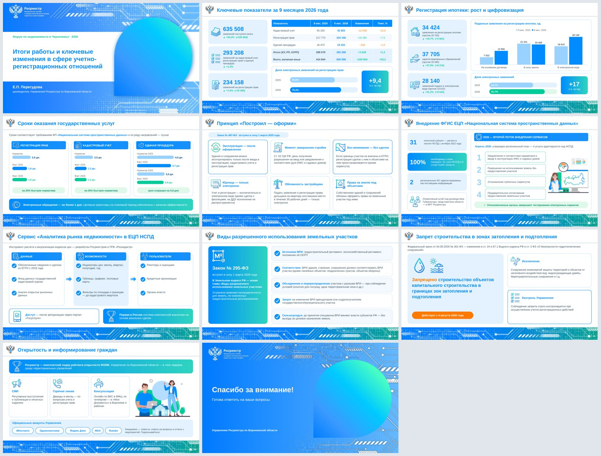
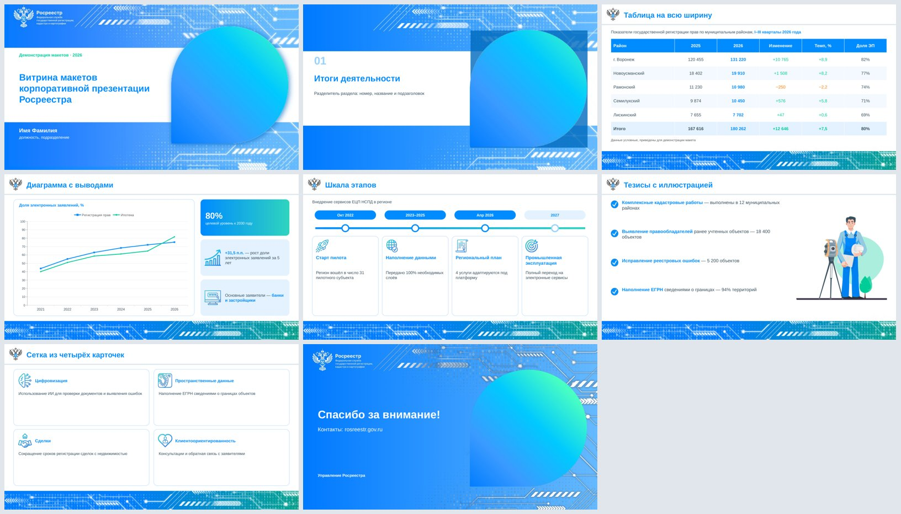

# Rosreestr Presentation Skill

**Скилл для ИИ-моделей: презентации PowerPoint в корпоративном стиле Росреестра.**

Модель читает доклад или справку, строит сторилайн и описывает слайды в JSON. Скрипт собирает **редактируемый** `.pptx` на фирменных фонах, с фирменными иконками, таблицами и живыми диаграммами, а затем рендерит превью для самопроверки. Скилл работает с Claude, ChatGPT, Gemini, GigaChat, YandexGPT, открытыми моделями через API, а также локально — без ИИ.



## Возможности

* **16 макетов**: титул, раздел, финал, KPI + таблица, KPI + диаграмма, «норматив / факт», сетка карточек, нумерованный перечень, закон с положениями, цепочка шагов, главный тезис, карточки с иллюстрацией, таблица, диаграмма с выводами, шкала этапов, тезисы.
* **Фирменные ассеты из официального шаблона**: 4 фона, логотип, **165 иконок** в синем и белом вариантах, 4 иллюстрации.
* **Автоподбор кегля** и предупреждения о переполнении текста, проверка имён иконок с подсказкой ближайшей.
* **Заметки докладчика**: полный текст доклада к каждому слайду.
* **Превью** через LibreOffice: PNG каждого слайда и сводный лист для визуальной проверки моделью.

## Структура репозитория

```
├── SKILL.md                  # главная инструкция для модели (формат Agent Skills)
├── docs/
│   ├── brand-guide.md        # фирменный стиль: палитра, шрифты, сетка, элементы
│   ├── layouts.md            # каталог макетов с превью и лимитами
│   ├── spec-format.md        # формат JSON-спецификации
│   └── icons.md              # каталог 165 иконок
├── prompts/system_prompt.md  # сжатая версия для Custom GPT / Gems / API
├── assets/                   # фоны, логотип, иконки (blue/white), иллюстрации
├── scripts/
│   ├── rosreestr_pptx.py     # библиотека макетов (класс Deck)
│   ├── build_from_spec.py    # сборка .pptx из JSON
│   ├── render_preview.py     # превью PNG через LibreOffice
│   ├── extract_assets.py     # извлечение ассетов из PDF-шаблона
│   ├── make_icon_catalog.py  # генерация каталога иконок
│   └── icon_names.py         # названия и смысл иконок
├── examples/                 # forum_2026 (реальный доклад), showcase (все макеты)
└── template/                 # исходный PDF-шаблон
```

## Установка

```bash
git clone https://github.com/astafjef2-blip/arena_shablon.git
cd arena_shablon
pip install -r requirements.txt
# для превью (необязательно): LibreOffice
#   Ubuntu/Debian: sudo apt install libreoffice-impress
#   macOS:         brew install --cask libreoffice
#   Windows:       https://www.libreoffice.org/download/
```

Проверка:
```bash
python scripts/build_from_spec.py examples/showcase.json -o out/showcase.pptx --preview
```

## Подключение к ИИ-моделям

### Claude (claude.ai, Claude Desktop, Claude Code)
Репозиторий оформлен как **Agent Skill**: в корне лежит `SKILL.md` с YAML-заголовком.
* **claude.ai / Desktop**: Settings → Capabilities → Skills → *Upload skill* → загрузите ZIP-архив репозитория.
* **Claude Code**: скопируйте папку в `~/.claude/skills/rosreestr-presentation/` (или в `.claude/skills/` проекта).
* Пример запроса: *«Сделай презентацию по докладу в корпоративном стиле Росреестра»* с приложенным PDF или DOCX.

### ChatGPT (Custom GPT)
1. Создайте GPT → *Configure*. В *Instructions* вставьте текст из `prompts/system_prompt.md`.
2. В *Knowledge* загрузите ZIP-архив репозитория (или `SKILL.md`, `docs/*.md` и архив `assets/` + `scripts/`).
3. Включите *Code Interpreter & Data Analysis*. GPT распакует архив, соберёт `.pptx` и отдаст файл.

### Gemini (Gems) / GigaChat / YandexGPT / другие ассистенты
Вставьте `prompts/system_prompt.md` в инструкции ассистента. Если у ассистента нет выполнения кода, он выдаст `spec.json`. Соберите его локально:
```bash
python scripts/build_from_spec.py spec.json -o presentation.pptx
```

### Любая модель через API (агентный сценарий)
Передайте `SKILL.md` в system prompt, дайте модели инструменты «выполнить команду» и «прочитать файл / изображение» и рабочую копию репозитория. Модель пройдёт цикл *spec → сборка → превью → правки* самостоятельно.

### Без ИИ: из Python
```python
import sys; sys.path.insert(0, "scripts")
from rosreestr_pptx import Deck

d = Deck()
d.title(title="Итоги работы за 9 месяцев 2026 года", kicker="Коллегия · 2026",
        author="И.И. Иванов", role="руководитель Управления")
d.cards(title="Ключевые изменения законодательства",
        intro="Закон № 487-ФЗ · с 1 марта 2025 года",
        cards=[{"icon": "buildings_house_cycle", "title": "Построил — оформи",
                "text": "Эксплуатация — только после регистрации прав"},
               {"icon": "maps_map_flag", "title": "Без межевания — без сделок",
                "text": "Регистрация сделок приостанавливается"}])
d.final(subtitle="Готов ответить на ваши вопросы")
d.save("out/deck.pptx")
```

## Макеты



Описание полей и лимитов — в [docs/layouts.md](docs/layouts.md), формат JSON — в [docs/spec-format.md](docs/spec-format.md).

## Обновление шаблона

Положите новый PDF в `template/rosreestr_template.pdf` и выполните:
```bash
python scripts/extract_assets.py
python scripts/make_icon_catalog.py
```

## Права на материалы

Код скилла (`scripts/`, документация) можно свободно использовать и изменять. Логотип, герб, фирменные фоны, иконки и иллюстрации из `assets/` и `template/` принадлежат Росреестру и предназначены **только для подготовки материалов Росреестра и его подведомственных организаций**. Подробнее — в [NOTICE.md](NOTICE.md).
